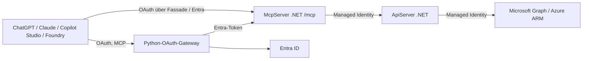

# Entra ID + MCP/API Server – Microsoft 365 Admin MCP

Produktiv deploybares Repo für:
- **API Server** (ASP.NET Core, .NET 10 LTS) – geschützt via Entra ID, unterstützt **App-only** (Client Credentials) **und** **Delegated** (Auth Code / On-Behalf-Of) Tokens
- **MCP Server** (ASP.NET Core, .NET 10 LTS + `ModelContextProtocol.AspNetCore` v2, Streamable HTTP, stateless) – ruft den API Server sowohl app-only als auch im Namen eines angemeldeten Nutzers auf, und liefert zusätzlich tenant-weit **Office 365 Status** (Service Health), **Message Center** (Nachrichten), **Adoption/Usage Reports** (92 Endpunkte) sowie **Intune-/Azure-Health** – der McpServer selbst hat keine Graph-Rechte, alle Graph-/ARM-Aufrufe laufen über den API Server (ADR-0002). Vorregistrierte OAuth-Clients für **ChatGPT**, **Claude** und **Copilot Studio** (siehe [`docs/DEPLOYMENT.md`](docs/DEPLOYMENT.md), Abschnitt "MCP OAuth Clients")
- **Infrastruktur als Code** – **Terraform** (`terraform/`, einziger aktiv gepflegter und über CI/CD verdrahteter Weg) für Azure App Service, Key Vault, Log Analytics/App Insights **und** alle Entra-ID-Objekte im selben State
- **CI/CD** – GitHub Actions (`.github/workflows/deploy.yml`), OIDC-Login (Workload Identity Federation, kein langlebiges Client-Secret für die Pipeline selbst), `main` ist geschützt (nur per Pull Request, siehe unten)

> Ein älterer, paralleler Bicep-Weg (`infra/`, `scripts/Set-EntraIdApps.ps1`, `scripts/Invoke-BicepWhatIf.ps1`, `scripts/Invoke-BicepDeploy.ps1`, `scripts/Get-EntraIdDiff.ps1`) existiert noch im Repo, ist aber **Legacy und nicht mehr aktiv gepflegt** – er läuft nicht im CI-Workflow. Siehe [Legacy: Bicep-Weg](#legacy-bicep-weg-nicht-aktiv-gepflegt) unten. Für alles Neue **immer Terraform verwenden**.

## Neueste Erweiterungen und Architekturänderungen

Stand 2026-10-17. Nur was tatsächlich umgesetzt und geprüft ist; Offenes steht ausdrücklich dabei.

- **Python-OAuth-Gateway (FastMCP 4.1.0)** in `src/OAuthGateway/`, in Dev auf einem eigenen B1-Plan (`entramcp-dev-oauth-gateway`). Es übernimmt Discovery, Dynamic Client Registration, CIMD und Consent für MCP-Clients, meldet Nutzer über eine zentrale Entra-App an und reicht das Entra-Token an den unveränderten .NET-Server weiter. **Nachgewiesen:** Entra-Login, `tools/list` (damals 18 Tools; `GetTasksDelegated` ist inzwischen entfernt, jetzt 17) und ein echter `tools/call` bis Microsoft Graph. **Offen:** Die ChatGPT-Anmeldung scheitert an der Client-Prüfung (Q-GW-1); Claude, Copilot Studio, Refresh und Re-Deploy sind nicht vollständig getestet. Details: [`docs/FASTMCP-GATEWAY-ARCHITECTURE.md`](docs/FASTMCP-GATEWAY-ARCHITECTURE.md), [`docs/FASTMCP-GATEWAY-TESTS.md`](docs/FASTMCP-GATEWAY-TESTS.md), [ADR-0017](docs/adr/0017-fastmcp-oauth-gateway.md) (Status: vorgeschlagen). Die .NET-OAuth-Fassade bleibt als Rollback aktiv ([`docs/FASTMCP-GATEWAY-ROLLBACK.md`](docs/FASTMCP-GATEWAY-ROLLBACK.md)).
- **Microsoft Foundry:** Self-Service-Anbindung per Skript `scripts/New-FoundryMcpClient.ps1` und Feld-für-Feld-Anleitung: [`docs/FOUNDRY-OAUTH.md`](docs/FOUNDRY-OAUTH.md) (nicht gegen ein echtes Foundry-Projekt getestet).
- **Sicherheits-Härtung:** Parametervalidierung für Report-Aufrufe (`date`, `appId`, `serviceArea`), zeitkonstanter API-Key-Vergleich, Patch einer verwundbaren NuGet-Abhängigkeit, NuGet-Audit in CI, Daten-Policy nur mit App-Rolle plus Zuweisungspflicht an der API-App, UserContext (Nutzer-ID nur für Audit), Rate Limiting, Request-Größenlimits und HSTS in allen drei Diensten (konfigurierbar, siehe [`docs/security/API-HARDENING.md`](docs/security/API-HARDENING.md)). Findings, Entscheidungen und offene Punkte: [`docs/security/`](docs/security/README.md), [`docs/adr/IMPLEMENTATION-AUDIT.md`](docs/adr/IMPLEMENTATION-AUDIT.md).
- **CI:** zusätzlicher Job `gateway-ci` (Lint, 51 Python-Tests, pip-audit, Gitleaks, Paketbau mit Import-Prüfung), `terraform fmt/validate`, NuGet-Schwachstellenprüfung, Gateway-Deploy mit Smoke-Test über den vorhandenen OIDC-Login.
- **Wiederverwendung und Planung:** [`docs/EXTENDING-MCP-PLATFORM.md`](docs/EXTENDING-MCP-PLATFORM.md), [`docs/REUSING-MCP-BASE.md`](docs/REUSING-MCP-BASE.md), [`docs/ROADMAP.md`](docs/ROADMAP.md), [`docs/OPEN-QUESTIONS.md`](docs/OPEN-QUESTIONS.md).

## Architekturüberblick



| Dienst | Verantwortung |
|---|---|
| `src/OAuthGateway` | OAuth-Discovery, DCR/CIMD, Consent, Token-Austausch; keine Graph-/ARM-/API-Rechte |
| `src/McpServer` | MCP-Endpunkt `/mcp`, 17 Tools (nur lesend), OAuth-Fassade (ADR-0004) |
| `src/ApiServer` | geschützte API, hält alle Graph-/ARM-Rechte (Managed Identity) |

**Tool-Gruppen (17):** Tasks (Demo, app-only), Service Health (Overview, Detail, Issues, degradierte Services), Message Center, Adoption-/Usage-Reports (Katalog mit 92 Reports über `list_adoption_reports`/`get_adoption_report`, zwei Detail-Kurzbefehle), Intune-/Microsoft-Health und Azure Service/Resource Health.

**Sicherheit:** siehe [`docs/security/`](docs/security/README.md). Wichtigste offene Punkte: keine nutzerbezogene Autorisierung (alle `Mcp.Access`-Nutzer sehen tenantweite Daten, F-004), Dienste öffentlich erreichbar (F-008).

**Tests:** `dotnet test EntraMcpMvp.sln` (180 Tests, nur ApiServer), `cd src/OAuthGateway && pytest tests` (58 Tests, Mock-IdP), Live-Test `src/OAuthGateway/tools/gateway_e2e.py`. Bekannte Lücken: kein Testprojekt für den McpServer; keine echten Client-Tests außer dem FastMCP-Client.

**Bekannte Einschränkungen:** Free-Tier-Kaltstart (F1) und Gateway-Containerstart von 2–3 Minuten (B1); ChatGPT-Anmeldung über das Gateway nicht funktionsfähig; MCP-Protokollstand `2025-11-25` (neuere Spezifikationen nicht nachgewiesen).

## Ordnerstruktur

```
M365AdminMCP/
├── src/
│   ├── ApiServer/        # ASP.NET Core Web API, Microsoft.Identity.Web
│   │   ├── Auth/          # GraphTokenService, GraphAuthOptions, PolicyNames
│   │   ├── Controllers/   # TasksController, M365StatusController, M365MessagesController, M365ReportsController
│   │   └── Services/      # GraphApiClient (Microsoft-Graph-Zugriff, CSV->JSON-Fallback)
│   ├── OAuthGateway/     # Python-FastMCP-OAuth-Gateway (gateway/, tests/, tools/)
│   └── McpServer/        # MCP Server (Streamable HTTP, stateless)
│       ├── Auth/          # ApiTokenService (OBO), McpAuthOptions, OAuthProxy (RFC-8707-Fassade vor Entra)
│       ├── Tools/          # TasksTool, M365StatusTool, M365MessagesTool, M365AdoptionTool, M365AdoptionCatalogTool
│       ├── Reporting/      # ReportCatalog.cs – Katalog aller 92 Adoption-/Usage-Report-Endpunkte
│       ├── Services/       # ApiServerClient (Aufrufe gegen den ApiServer)
│       └── Utils/          # CsvJsonConverter
├── terraform/            # EINZIGER aktiv genutzter Deployment-Weg (siehe docs/DEPLOYMENT.md)
│   ├── main.tf, providers.tf, variables.tf, outputs.tf
│   ├── terraform.dev.tfvars
│   └── modules/
│       ├── entra-id/     # azuread_application, App Roles, Graph-Permissions, OAuth-Clients, Admin Consent
│       ├── infra/        # azurerm: Resource Group, App Service Plan, 2 Linux Web Apps, Key Vault, Monitoring, RBAC
│       └── gateway/      # optional (enable_gateway): eigener Plan, Python-Web-App, Storage, Key-Vault-Secrets
├── infra/                # LEGACY: Bicep-Alternative, nicht im CI verdrahtet (siehe unten)
├── scripts/                                          # PowerShell 7 (.ps1) - macOS/Windows/Linux
│   ├── Connect-Azure.ps1                             # liest .env, az login/account set auf Tenant+Subscription
│   ├── Install-Prerequisites.ps1                     # installiert dotnet, az, gh, terraform falls fehlend
│   ├── New-GitHubRepo.ps1                            # Repo-Setup via GitHub CLI (gh)
│   ├── Initialize-TerraformBackend.ps1               # einmalig: Remote-State-Storage-Account anlegen
│   ├── Invoke-TerraformPlan.ps1, Invoke-TerraformApply.ps1
│   ├── Export-TerraformLocalSettings.ps1             # schreibt .env + appsettings.Development.json aus TF-Outputs
│   ├── Add-McpOauthRedirectUri.ps1                    # neue ChatGPT/Claude/Copilot-Redirect-URI nachtragen
│   ├── Set-GitHubActionsSettings.ps1                  # setzt GitHub Actions Secrets/Variables per gh CLI
│   ├── Stop-LocalDebugServers.ps1                     # killt lokale dotnet-Prozesse auf den Debug-Ports
│   └── (Legacy, Bicep) Set-EntraIdApps.ps1, Invoke-BicepWhatIf.ps1, Invoke-BicepDeploy.ps1, Get-EntraIdDiff.ps1
├── docs/
│   ├── ARCHITECTURE.md      # Systemarchitektur, Auth-Flows, MCP-Tool-Katalog, Report-Katalog
│   ├── ENTRA-ID-SETUP.md    # Entra-ID-Objekte im Detail, Berechtigungs-Bootstrap für CI
│   ├── DEPLOYMENT.md        # Terraform-Deployment, CI/CD-Ablauf, Kosten, MCP-OAuth-Clients
│   └── WHATIF-GUIDE.md      # terraform plan / Review-Workflow
├── AGENTS.md             # Kompakte Anweisungen für Codex/Claude Code bei Neuaufsetzen dieses Repos
├── .env.example                                      # Vorlage für .env (Tenant/Subscription, nicht committen)
└── .github/workflows/deploy.yml                      # Build -> Terraform Plan (PR) / Apply+Deploy (main)
```

## Voraussetzungen

- .NET 10 SDK (aktuelle LTS) – `Install-Prerequisites.ps1` installiert es automatisch, falls keine SDK-Version ≥ 10 gefunden wird
- **PowerShell 7** (`pwsh`) – alle Skripte in `scripts/` sind `.ps1` und laufen identisch unter macOS, Windows und Linux
- Azure CLI (`az`) ≥ 2.60, eingeloggt mit einem Konto mit **Application Administrator** (Entra-ID-Rolle) und **Contributor + User Access Administrator** (bzw. Owner) auf der Ziel-Subscription/Resource Group – siehe [Berechtigungs-Bootstrap](docs/ENTRA-ID-SETUP.md#berechtigungs-bootstrap-fuer-cicd-neu-fuer-jede-neue-umgebung) für die exakten Rollen, falls stattdessen ein Service Principal für CI/CD eingerichtet wird
- **GitHub CLI** (`gh`) – für Repo-/Actions-Setup; wird von `Install-Prerequisites.ps1` automatisch installiert, falls nicht vorhanden
- **Terraform** ≥ 1.7
- Ein Entra-ID-Tenant, in dem du App-Registrierungen anlegen darfst
- Lokale `.env` (aus `.env.example` kopiert) mit `AZURE_TENANT_ID` und `AZURE_SUBSCRIPTION_ID` – wird von `scripts/Connect-Azure.ps1` gelesen, das alle Deployment-Skripte automatisch als ersten Schritt aufrufen

Fehlende CLIs (dotnet, az, gh, terraform) lassen sich in einem Rutsch installieren:

```powershell
pwsh ./scripts/Install-Prerequisites.ps1
```

## Schnellstart (lokale Entwicklung / neue Umgebung)

```powershell
# 1) Tenant/Subscription hinterlegen (einmalig)
Copy-Item .env.example .env
# .env öffnen und AZURE_TENANT_ID / AZURE_SUBSCRIPTION_ID eintragen

# 2) Anmelden (alle scripts/*.ps1, die Azure-Ressourcen anlegen/ändern, rufen dies automatisch
#    selbst als ersten Schritt auf - manueller Aufruf hier nur zur Kontrolle)
pwsh ./scripts/Connect-Azure.ps1

# 3) einmalig pro Tenant/Subscription: Terraform Remote-State-Backend anlegen
pwsh ./scripts/Initialize-TerraformBackend.ps1 -StorageAccountName <global-eindeutiger-name>
# -> Ausgabe in terraform/providers.tf im backend "azurerm"-Block eintragen

# 4) Plan + Apply (Azure-Ressourcen UND Entra-ID-Objekte in einem gemeinsamen State)
pwsh ./scripts/Invoke-TerraformPlan.ps1 -Environment dev
pwsh ./scripts/Invoke-TerraformApply.ps1 -Environment dev   # fragt vor dem Apply nochmal nach, bricht bei Löschungen ohne -Force ab

# 5) lokale appsettings.Development.json + .env automatisch befüllen (läuft am Ende von Schritt 4 bereits automatisch mit)
pwsh ./scripts/Export-TerraformLocalSettings.ps1 -Environment dev

# 6) Server lokal starten
dotnet run --project src/ApiServer   # http://localhost:5043 / https://localhost:7043
dotnet run --project src/McpServer   # http://localhost:5143 / https://localhost:7143

### Lokal testen mit dem MCP Inspector (VS Code Debug)

Voraussetzungen: Node.js ≥ 22.19.0, PowerShell 7, lokale `appsettings.Development.json` (`pwsh ./scripts/Export-TerraformLocalSettings.ps1 -Environment dev`).

Konfiguration **„Debug API + MCP + Inspector“** wählen und **F5** drücken. Das startet nacheinander: Aufräumen eigener Alt-Prozesse → Build →
gepinnten [MCP Inspector](https://github.com/modelcontextprotocol/inspector) v2 (`tools/mcp-inspector`, `127.0.0.1:6274`, zufälliger Sitzungstoken) → ApiServer + McpServer im Debugger.
Sobald beide `/healthz` beantworten, öffnet sich der Browser und der Inspector verbindet sich selbst mit `http://localhost:5143/mcp`; die 17 Tools sind sofort sichtbar, Breakpoints in MCP und API greifen.
Beim Beenden der Debug-Session werden Inspector und Server-Prozesse dieses Repos beendet. Details, Sicherheit und Fehlerbilder: [`docs/DEBUGGING.md`](docs/DEBUGGING.md), [ADR-0015](docs/adr/0015-lokales-debugging-mit-inspector.md).

`McpAuth__RequireAuthentication=false` gilt nur in dieser Launch-Konfiguration. Außerhalb von `Development` verweigert der Server den Start, und ohne Auth sind nur Loopback-Aufrufe
mit `localhost`-Host-Header erlaubt (Tunnel werden mit 403 abgewiesen). Das Azure-Deployment (OAuth, Managed Identity, Terraform) bleibt unverändert.

```

Details zu allen Terraform-Ressourcen, Kosten, CI/CD-Ablauf und den MCP-OAuth-Clients: siehe [`docs/DEPLOYMENT.md`](docs/DEPLOYMENT.md). Vollständige Architektur inkl. Auth-Flows und Tool-Katalog: siehe [`docs/ARCHITECTURE.md`](docs/ARCHITECTURE.md).

## Branch-Strategie & Weiterentwicklung

`main` ist geschützt (Pull-Request-Pflicht, Pflicht-Status-Checks `build` + `deploy-dev`, kein Direct-Push, gilt auch für Repo-Admins). Ein Merge nach `main` löst automatisch Build → Terraform Apply → Deploy in die `dev`-Umgebung aus.

Für neue Features/Doku-Arbeit:

```powershell
git checkout main
git pull
git checkout -b feature/<kurzer-name>    # oder docs/<kurzer-name>
# ... Änderungen ...
git push -u origin feature/<kurzer-name>
gh pr create --base main
```

Der PR triggert automatisch `terraform-plan` (Diff als PR-Kommentar). Nach Freigabe/Merge läuft `deploy-dev` automatisch. Siehe [`docs/WHATIF-GUIDE.md`](docs/WHATIF-GUIDE.md) für den Review-Workflow und [`AGENTS.md`](AGENTS.md) für eine kompakte Übersicht, falls ein KI-Coding-Agent (Codex/Claude Code) an diesem Repo weiterarbeiten soll.

## Legacy: Bicep-Weg (nicht aktiv gepflegt)

```powershell
pwsh ./scripts/Set-EntraIdApps.ps1 -Environment dev    # Entra ID vorbereiten (idempotent)
pwsh ./scripts/Invoke-BicepWhatIf.ps1 -Environment dev # Azure what-if + Entra Config-Diff
pwsh ./scripts/Invoke-BicepDeploy.ps1 -Environment dev # Deployment (fragt vor dem Apply nochmal nach)
```

Dieser Weg existiert noch als Referenz/Ideengeber (u. a. für die Microsoft-Graph-Bicep-Extension, Preview-Feature), wird aber **nicht mehr weiterentwickelt und läuft nicht im GitHub-Actions-Workflow**. Neue Umgebungen und Änderungen bitte ausschließlich über Terraform vornehmen.

## Wichtige Hinweise

- Secrets werden lokal nur temporär gehalten und landen im Key Vault – nie im Klartext ins Git-Repo committen (`.gitignore` ist entsprechend vorbereitet).
- Das Repository ist **öffentlich** (GitHub Free-Plan erlaubt Branch-Protection nur bei öffentlichen Repos). Es sind keine echten Secrets im Code oder in der Historie enthalten – alle sensiblen Werte (Client-Secrets, Terraform-Outputs) sind über `sensitive = true` markiert bzw. liegen ausschließlich im Azure Key Vault.
- Dies ist ein reales, produktiv deploybares Setup (nicht nur ein Proof-of-Concept) – es fehlen aber bewusst manche Enterprise-Härtungen (siehe "Offene Architektur-Fragen" in [`docs/ARCHITECTURE.md`](docs/ARCHITECTURE.md)), z. B. Multi-Tenant-Unterstützung, Zertifikat statt Client-Secret, Netzwerksegmentierung.

## Entwickler-Dokumentation

- [`docs/CODE-REFERENCE.md`](docs/CODE-REFERENCE.md) – Code-Segmente im Detail
- [`docs/adr/`](docs/adr/README.md) – Architecture Decision Records (17 Einträge), [Implementierungsaudit](docs/adr/IMPLEMENTATION-AUDIT.md)
- [`docs/security/`](docs/security/README.md) – Sicherheitsarchitektur, Threat Model, Findings, Pentest-/Audit-Vorbereitung
- [`docs/FASTMCP-GATEWAY-ARCHITECTURE.md`](docs/FASTMCP-GATEWAY-ARCHITECTURE.md) und weitere `docs/FASTMCP-GATEWAY-*.md` – Gateway
- [`docs/FOUNDRY-OAUTH.md`](docs/FOUNDRY-OAUTH.md) – Microsoft-Foundry-Anbindung
- [`docs/EXTENDING-MCP-PLATFORM.md`](docs/EXTENDING-MCP-PLATFORM.md), [`docs/REUSING-MCP-BASE.md`](docs/REUSING-MCP-BASE.md) – Plattform erweitern
- [`docs/ROADMAP.md`](docs/ROADMAP.md), [`docs/OPEN-QUESTIONS.md`](docs/OPEN-QUESTIONS.md)
- [`docs/DESIGN-DECISION-MAP.md`](docs/DESIGN-DECISION-MAP.md) – Entscheidung → Code-Fundstelle
- [`docs/DEPLOYMENT-RUNBOOK.md`](docs/DEPLOYMENT-RUNBOOK.md) – exakter Deployment-Ablauf
- [`docs/DEBUGGING.md`](docs/DEBUGGING.md) – lokales Debugging, Inspector, Fehlerbilder
- [`docs/PROMPTING-GUIDE.md`](docs/PROMPTING-GUIDE.md) – Prompt-Vorlagen für KI-Coding-Agenten
- [`docs/microsoft-health/`](docs/microsoft-health/01-existing-architecture.md) – Intune-/Azure-Health-Tools: Architektur, Implementierung, Berechtigungen, Terraform, Betrieb
