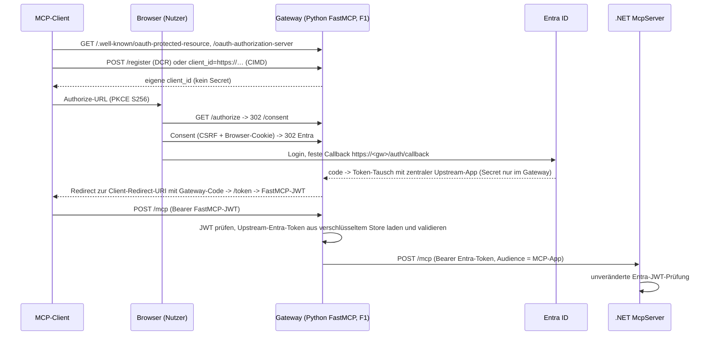

# FastMCP OAuth Gateway – Architektur

Status: **implementiert, nicht deployt**; Gates G1–G7 siehe [FASTMCP-GATEWAY-TESTS.md](FASTMCP-GATEWAY-TESTS.md). Feature-Flag `enable_gateway=false` (Default).

## Bestehende Architektur (unverändert)
Clients → .NET McpServer (`/mcp`, eigene OAuth-Fassade `src/McpServer/Auth/OAuthProxy.cs`, Entra-JWT-Validierung `Program.cs:44-57`) → .NET ApiServer (Managed Identity) → Graph/ARM (Managed Identity). Vorregistrierte Entra-Clients je Connector (ADR-0005).

## Neue Zielarchitektur

Komponenten
- `src/OAuthGateway/gateway/app.py` – ASGI-App: `AzureProvider` (FastMCP 4.1.0), `/healthz`, `/readyz`, verschlüsselter Azure-Tables-Store.
- `gateway/server.py` – Proxy zum .NET-`/mcp`; `_UpstreamBearer` setzt je Request das **Upstream-Entra-Token** (nie das FastMCP-JWT).
- `gateway/config.py` – Fail-fast-Validierung; Secrets nur aus App Settings (Key-Vault-Referenzen).

## Vertrauensgrenzen
| Grenze | Mechanismus |
|---|---|
| Client → Gateway | FastMCP-JWT (HS256, `jwt_signing_key` aus Key Vault) |
| Gateway → Entra | Authorization Code + PKCE, Confidential Client, feste Callback-URL |
| Gateway → .NET | Entra-Access-Token des Nutzers (aud = MCP-App, scp `Mcp.Access`), vom .NET selbst validiert |
| .NET → API/Graph/ARM | unverändert Managed Identity |

Das Gateway besitzt **keine** API-/Graph-/ARM-Rechte. Delegierte/OBO-Funktionen: unverändert nicht verfügbar in Produktion (`UseManagedIdentity=true`, `src/McpServer/Auth/ApiTokenService.cs:75-78`); die Tools laufen app-only über die MI des MCP-Servers, unabhängig vom Gateway.

## Nicht eingeführt
APIM, Keycloak, Container Apps/Registry, AKS, VMs, kostenpflichtige Pläne, Docker.

## Bekannte Einschränkungen
- Direkter Zugriff auf den .NET-`/mcp` bleibt möglich (öffentlicher Hostname, F1 ohne Private Networking).
- F1: kein Always On → Cold Start (siehe Tests/Kosten).
- Confidential-DCR mit ausgegebenem Client-Secret wird von FastMCP 4.1.0 **nicht** unterstützt: `register_client` speichert jeden Client als public client mit `token_endpoint_auth_method="none"` und setzt `client_secret=None` (`fastmcp/server/auth/oauth_proxy/proxy.py`, `register_client`). Clients, die zwingend ein Secret-Feld verlangen (Copilot Studio „Manuell“), brauchen weiterhin die bestehende vorregistrierte App oder DCR/„Dynamic discovery“.
