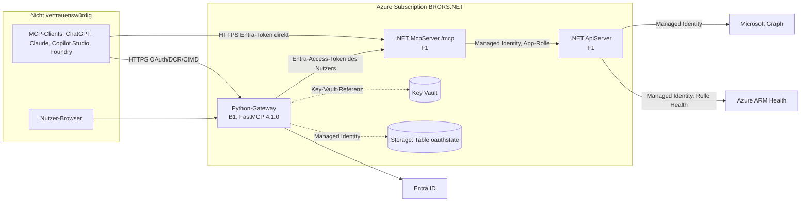

# Sicherheitsarchitektur

## Vertrauensgrenzen und Datenflüsse

## Öffentliche Schnittstellen (Stand live geprüft)
| Endpunkt | Schutz |
|---|---|
| Gateway `/mcp` | FastMCP-JWT (HS256); ohne Token 401 mit `resource_metadata` |
| Gateway `/.well-known/*`, `/register`, `/authorize`, `/consent`, `/token`, `/auth/callback` | öffentlich nach OAuth-Protokoll; Consent mit CSRF und Browser-Bindung (Tests) |
| Gateway `/healthz`, `/readyz` | öffentlich, ohne Daten |
| McpServer `/mcp` | Entra-JWT (Audience MCP-App, Scope/Rolle `Mcp.Access`); optional `X-MCP-API-Key` (in Azure nicht konfiguriert) |
| McpServer `/authorize`, `/token`, `/.well-known/*` | OAuth-Fassade (ADR-0004) |
| ApiServer | Entra-JWT, Policy `TasksReadWrite` (App-Rolle `Tasks.ReadWrite.All` oder Scope) |

## Privilegierte Identitäten
| Identität | Rechte |
|---|---|
| MI McpServer | App-Rolle `Tasks.ReadWrite.All` auf der API-App; Key Vault Secrets User |
| MI ApiServer | Graph: `ServiceHealth.Read.All`, `ServiceMessage.Read.All`, `Reports.Read.All`; ARM: *Service Health Security Reader* auf freigegebenen Subscriptions |
| MI Gateway | Key Vault Secrets User; Storage Table Data Contributor; **keine** Graph-/ARM-/API-Rechte |
| CI-Principal `sp_keyvault` | Contributor auf `rg-entramcp-dev`, RBAC Administrator auf Subscription und Key Vault, Graph `Application.ReadWrite.All` (laut `AGENTS.md`, nicht erneut geprüft) |

## Berechtigungsmodell
Zugriff auf alle Tools = Scope/Rolle `Mcp.Access`. Es gibt **keine** Rechte pro Datenbereich oder Nutzer (F-004/F-005). Die Daten sind tenantweit.

## Netzwerkgrenzen
Alle Dienste sind über öffentliche `*.azurewebsites.net`-Hostnamen erreichbar; es gibt kein VNet, keinen Private Endpoint, keine IP-Restriktion (F-008).

## Secret-Flüsse
Entra-Secrets entstehen in Terraform → Key Vault → Key-Vault-Referenz in App Settings → Prozess. Gateway-Schlüssel (`random_password`) ebenso. Alles liegt zusätzlich im Terraform-State (F-013). Siehe [SECRETS-MANAGEMENT.md](SECRETS-MANAGEMENT.md).

## Schutzmaßnahmen (belegt)
JWT-Validierung (Signatur, Issuer, Audience) in .NET und Gateway; PKCE S256; Consent mit CSRF/Browser-Bindung; Redirect-Manipulation und PKCE-Bypass in Tests abgewiesen; Report-Parameter validiert; HTTP-Clients ohne Redirects für Health/Graph; Allowlist für Azure-Subscriptions; Secret-Maskierung im Gateway-Log; Löschschutz im Terraform-Apply.
